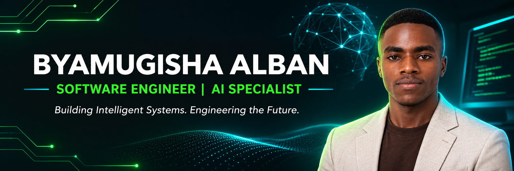

<!--
  BYAMUGISHA ALBAN | CYBER FUSION
  AI ENGINEER & SOFTWARE ENGINEER
-->

<!-- ======================== HERO BANNER ======================== -->

  

  

  
  
  

  
  
  

  

<!-- ======================== ABOUT ME ======================== -->

<h2>
  
</h2>

I'm **Byamugisha Alban**, a Software Engineer passionate about **Artificial Intelligence and AI Engineering**.

I enjoy exploring how AI can solve real-world problems, developing software applications, and turning innovative ideas into practical, intelligent solutions.

My journey combines software engineering fundamentals with a growing focus on AI, Generative AI, Large Language Models, and intelligent applications.

I'm driven by curiosity, continuous learning, and the ambition to build technology that makes a meaningful difference.

  
<b>⌨️ Initialize Developer Terminal</b>

   

  

    
  

  <pre>
root@alban:~$ whoami
Byamugisha Alban

root@alban:~$ primary_focus
AI Engineering &amp; Intelligent Systems

root@alban:~$ background
Software Engineering

root@alban:~$ exploring
Generative AI, LLMs, NLP, APIs, Cloud &amp; Full-Stack Development

root@alban:~$ mission
Build useful, intelligent, and impactful technology.

root@alban:~$ mindset
Learn continuously. Build boldly. Innovate with AI.
  </pre>

  

<!-- ======================== MISSION CONTROL ======================== -->

<h2>
  
</h2>

<table>
  <tr>
    <td width="50%" valign="top">
      <h3>🤖 Primary Mission</h3>
      
Grow as an AI Engineer and develop intelligent solutions that address real-world challenges.

    </td>
    <td width="50%" valign="top">
      <h3>💻 Engineering Foundation</h3>
      
Apply software engineering principles to build reliable, maintainable, and useful applications.

    </td>
  </tr>
  <tr>
    <td width="50%" valign="top">
      <h3>🧠 AI Exploration</h3>
      
Explore Generative AI, Large Language Models, NLP, and AI-powered application development.

    </td>
    <td width="50%" valign="top">
      <h3>🚀 Long-Term Vision</h3>
      
Build and deploy intelligent software that combines AI capabilities with practical engineering.

    </td>
  </tr>
</table>

### 🎯 Current Interests

- 🤖 Artificial Intelligence and AI Engineering
- 🧠 Generative AI and Large Language Models (LLMs)
- 💬 Natural Language Processing (NLP)
- 💻 Full-Stack and Backend Engineering
- ☁️ Cloud Technologies and Application Deployment
- 🔌 APIs, Microservices, and System Integration
- 🗄️ Database Design and Data Management
- 🌍 GIS and technology-driven solutions

  

<!-- ======================== LANGUAGES & TOOLS ======================== -->

<h2>
  
</h2>

  <i>My engineering toolkit — writing code, exploring AI, and building intelligent solutions.</i>

### 🧠 AI & Machine Learning

  
  
  
  

### 💻 Programming Languages

  
  
  
  
  
  
  

### 🌐 Web & Backend Engineering

  
  
  
  

### 🗄️ Databases & Data

  
  
  

### ☁️ Cloud, DevOps & Version Control

  
  
  
  

### 🛠️ Development Tools & IDEs

  
  
  
  
  

### 🖥️ Operating Systems

  
  
  

  ⚡ Exploring new technologies and expanding my engineering toolkit.

  

<!-- ======================== FEATURED PROJECTS ======================== -->

<h2>
  
</h2>

  <i>Selected projects demonstrating my software engineering journey.</i>

<table>
  <tr>
    <td width="50%" valign="top">
      <h3>🚀 Software Engineering Portfolio</h3>
      
My portfolio showcases my engineering background, skills, and projects.

      

        
      

      

        
      

    </td>
    <td width="50%" valign="top">
      <h3>☕ IT Procurement System</h3>
      
A Java application using Swing, JDBC, and MySQL for IT procurement requests.

      

        
      

    </td>
  </tr>
</table>

  

  

<!-- ======================== GITHUB ANALYTICS ======================== -->

<h2>
  
</h2>

  <i>My open-source activity, coding languages, and contribution journey.</i>

  
  

  

  

  

<!-- ======================== NEXT OBJECTIVES ======================== -->

<h2>
  
</h2>

<table>
  <tr>
    <td valign="top" width="50%">
      <h3>🤖 AI Engineering</h3>
      <ul>
        <li>Deepen my understanding of AI and machine learning.</li>
        <li>Explore Generative AI and LLM-powered applications.</li>
        <li>Learn effective AI integration and evaluation practices.</li>
        <li>Build practical, intelligent solutions.</li>
      </ul>
    </td>
    <td valign="top" width="50%">
      <h3>🚀 Software Engineering</h3>
      <ul>
        <li>Strengthen software architecture and design.</li>
        <li>Improve API and backend development skills.</li>
        <li>Explore cloud deployment and DevOps workflows.</li>
        <li>Build reliable, maintainable applications.</li>
      </ul>
    </td>
  </tr>
</table>

  

  

<!-- ======================== CONTACT ======================== -->

<h2>
  
</h2>

  <i>Have an idea, an opportunity, or an interesting technology to discuss? Let's connect!</i>

### 💼 Professional

  
  
  
  

### 👨‍💻 Developer & Community

  
  
  
  

### 🌍 Social Media

  
  
  
  

### 📞 Direct Contact

  
  

  

<!-- ======================== FOOTER ======================== -->

  <b>⚡ BUILT WITH CURIOSITY. POWERED BY CODE. INSPIRED BY AI. ⚡</b>

  <i>"The future belongs to those who keep learning, building, and innovating."</i>

  

